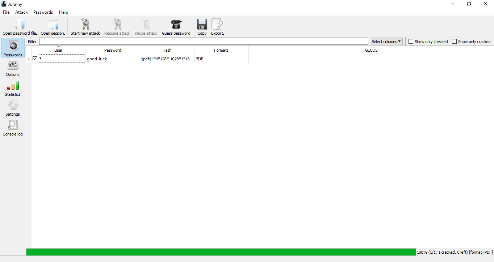
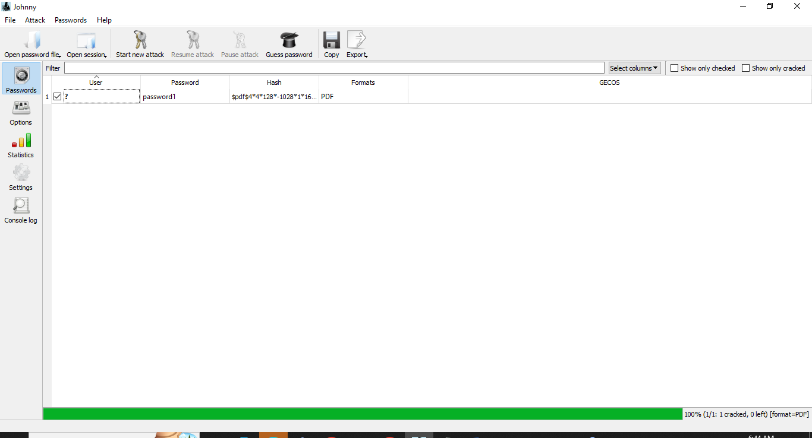
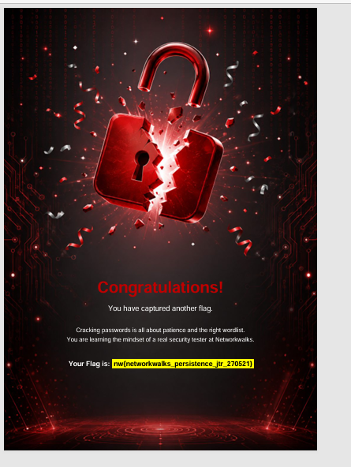
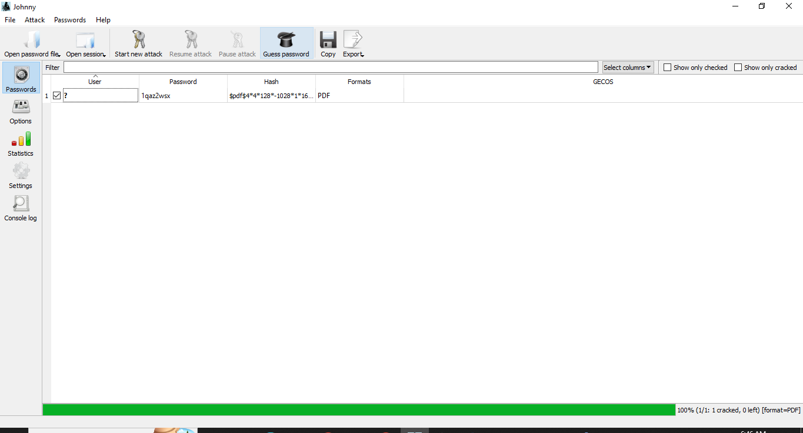

### 1. John the Ripper
- Password security auditing tool.
- Supports multiple password hash formats.
- Helps understand password strength and hash security.
- Useful for authorized password auditing.

## 🧪 Practical Guide

This section provides practical exercises for learning password hash identification and password security auditing.

Users can download the PDF practice files available in this repository and follow the instructions below.

### Step 1: Download Practice Files
- Navigate to the PDF files in this repository.
- Download the practice PDF.

### Step 2: Identify the PDF Hash
- Open the following hash extraction website:
  https://www.onlinehashcrack.com/tools-pdf-hash-extractor.php
- Upload your practice PDF file.
- Extract and note down the hash value.

### Step 3: Install John the Ripper
- Download John the Ripper for Windows:
  https://www.openwall.com/john/
- Download Johnny GUI:
  https://openwall.info/wiki/john/johnny
- Install and open the tool.
- Prepare a text file named `hash.txt` containing the extracted hash in the format expected by John the Ripper.

### Step 4: Perform Authorized Password Auditing
- Select the appropriate hash format.
- Use John the Ripper with an authorized test wordlist.
- Observe the results.
- Understand password strength and security.

### Step 5: Analyze the Results
- Record the identified hash format.
- Document the auditing results.
- Understand the importance of strong passwords.

## 📄 My locked1 pdf
[📥 Click Here to View PDF](My_Locked1.pdf)

Hash value and Password 

Flag

## 📄 My locked2 pdf
[📥 Click Here to View PDF](My_Locked2.pdf)

Hash value and Password 

Flag

## 📄 My locked1 pdf
[📥 Click Here to View PDF](My_Locked3.pdf)

hash value 

Flag 

