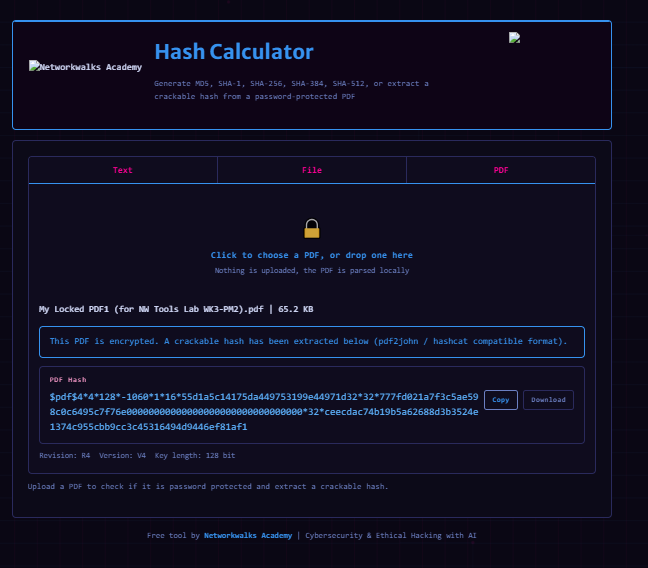
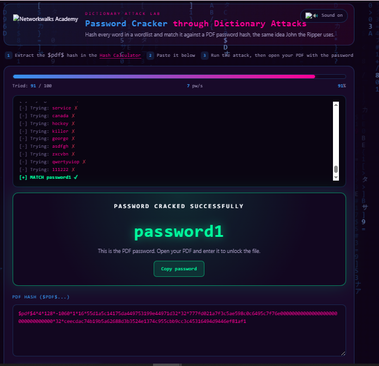

### 2. NetworkWalks Password Cracker & Hash Cracker
- Used for learning about password and hash analysis.
- Helps understand password security concepts.
- Included for educational and authorized security testing.

### 🧪 Practical Guide

### Step 1: Open NetworkWalks
- Open your web browser.
- Visit the NetworkWalks website.
  https://networkwalks.com/hash-calculator/
- Navigate to the Hash Cracker section.

### Step 2: Enter the Hash Value
- Use the sample hash extracted from your practice PDF.
  
[Click Here to View pdf ](My_Locked4.pdf)
- Copy the hash value.
  

### Step 3: Use the Password Cracker
- Navigate to the Password Cracker section.
- Follow the website's instructions.
  https://networkwalks.com/password-cracker/
- enter the hash value then start the attack
  

### Step 4: Analyze the Results
- Observe the output provided by the website.
- Record the results.
  

